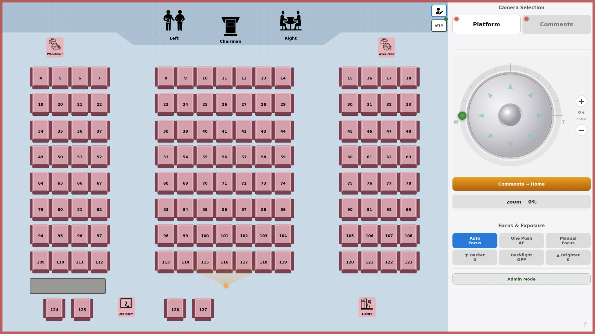

# KH PTZ Control

[Project website](docs/index.html) · [Install](#install) · [Operator guide](docs/OPERATOR_GUIDE.md) · [Troubleshooting](#camera-troubleshooting)

The static project website is included in this repository; see
[preview and GitHub Pages publication](docs/PAGES.md). A live URL will be added
after an administrator enables Pages.

Touchscreen control of VISCA-over-IP PTZ cameras on a Raspberry Pi. The operator
taps a seat on a visual auditorium layout to recall its saved framing, with
separate Platform and Comments camera roles and manual joystick, zoom, focus
and exposure controls.

Free and open-source (MIT). This is an installable application under active camera
stability work. Automated tests and a successful install do not replace physical validation
of both cameras, saved framing, STOP and recovery on your own equipment. The original application code is
MIT-licensed. Required GUI dependencies and optional components have separate
licences; see [third-party notices](THIRD_PARTY_NOTICES.md) and the
[ATEM dependency gate](docs/ATEM_DEPENDENCY_DECISION.md) before sharing an installed
system or deploying ATEM support.

## Start here

| Your task | Read first | What to check |
| --- | --- | --- |
| Install a Raspberry Pi | [Installation guide](docs/INSTALL_RPI.md) | Desktop and X11 ready, readiness PASS, wizard, physical rehearsal |
| Operate the cameras | [Operator guide](docs/OPERATOR_GUIDE.md) | Selected camera and session, CALL vs SET, STOP and physical fallback |
| Diagnose a problem | [Troubleshooting](#camera-troubleshooting) | Preserve logs and backups; stop the GUI before standalone diagnostics |
| Understand the code | [Architecture](docs/ARCHITECTURE.md) | Presentation, use cases, domain, adapters and runtime boundaries |

## What it does

- **Visual seat map.** Tap a numbered seat (or a platform position: chairman, lectern,
  reader) and the selected camera moves to the stored preset for that spot.
- **Two cameras.** A "Platform" camera and a "Comments" camera, selected on screen.
- **Presets per seat.** Call mode for live operation; Set mode to store or update the
  framing for any seat in seconds.
- **Session controls.** Meeting schedules and explicit session controls keep normal
  operation separate from setup and shutdown. Check the on-screen session state
  before using camera controls.
- **Operator login.** A simple on-screen password protects the controls; an admin role
  unlocks configuration.
- **ATEM integration (optional).** Camera status can follow the video switcher.
- **Simulation mode.** Fake/demo components support operator UI rehearsal without
  camera hardware; they do not validate a full Raspberry Pi installation.



## Safety: STOP is always first

Cameras move; safety is not negotiable. The control path is built so that STOP always
wins:

- A STOP command **queues a pan/tilt stop and a zoom stop together with priority**;
  physical stopping then depends on the camera and the network.
- STOP commands travel in a **priority queue** that bypasses every pending movement.
- If the command queue is full, **new movement commands are dropped — never a STOP**.
- Closing the app or ending a session requests a stop for configured cameras;
  confirm the physical result and use the venue's fallback if the network fails.

## Operator screen

The screenshot was generated from the current application in an isolated local
simulation on 11 November 2026, using the repository background. It contains no
personal names or device addresses. Connection indicators are simulated, not a
hardware-validation result.

## What this project does not do

- Guarantee compatibility with every VISCA-over-IP camera or switcher model.
- Prove physical movement, saving or stopping from a green indicator or CI result.
- Store the camera's physical preset memory inside a seating-layout backup.
- Replace equipment rehearsal, a physical fallback or ATEM licence review.

## Requirements

- Raspberry Pi hardware with Raspberry Pi OS. Two software targets, both with
  physical validation required on the target equipment:
  - **Pi 4 or 5 / Bookworm (Debian 12) 64-bit Desktop with Python 3.11** - the installation
    target, rehearsed in a container. Bookworm boots to Wayland by default and the
    GUI requires X11: switch the session with `sudo raspi-config` -> Advanced
    Options -> Wayland -> X11 and reboot before installing. Do not use `--atem` or
    `--dev` on Bookworm (PEP 668 blocks `pip3` there).
  - **Pi 4 / Bullseye (Debian 11) 64-bit with Python 3.9.2** - the legacy baseline,
    still supported. Trixie is not validated.

  See [docs/INSTALL_RPI.md](docs/INSTALL_RPI.md) and
  [docs/RPI_RUNTIME_BASELINE.md](docs/RPI_RUNTIME_BASELINE.md).
- A touchscreen (the UI is designed for touch) and network access to the cameras.
- One or two VISCA-over-IP PTZ cameras (designed for common AV/PTZ heads; not yet
  universally validated across camera models).
- The system Python of the chosen target (3.11 on Bookworm, 3.9.2 on Bullseye;
  other versions are not supported targets) with PyQt5 (installed from `apt` on
  Raspberry Pi OS).

## Install

On a fresh Raspberry Pi OS Bookworm 64-bit Desktop system with an X11 session
(Bullseye remains the legacy baseline; see [Requirements](#requirements)):

```bash
git clone https://github.com/HALCONDEORO/kh-ptz-control.git khptz
cd khptz
bash install_khptz_rpi.sh --guide
```

The guide explains the steps. For the manual readiness check and installation:

```bash
sudo bash install_khptz_rpi.sh --wizard-user "$USER" --check
sudo bash install_khptz_rpi.sh --wizard-user "$USER"
```

Run this from the Pi desktop as your normal user. `--wizard-user` names that
existing desktop user, not the service account created by the installer.
Run the second command only if readiness passes. For a supervised first installation, use the reviewed, CI-green commit approved
from `main` and record its full SHA; use the signed-off release tag when available.
See [the short installation checklist](docs/INSTALL_TODAY_ES.md). CI passing is not a physical Pi validation result.
Exit 20 means configuration is still required; exit 30 means stop and inspect
the failure. Keep the installer output and never paste passwords into reports.

The installer creates the `khptz` service user, installs dependencies, sets up the
systemd service and the autostart session, and prints the next action: reboot and log into the desktop, or run
`khptz setup` there. The first-run wizard collects camera IPs, seat layout
and login settings. Follow the current wizard prompts; do not use a default password.

The full guide — prerequisites, validation, backup/restore, rollback and
troubleshooting — is [docs/INSTALL_RPI.md](docs/INSTALL_RPI.md).
New to the project? Follow the [installation checklist](docs/INSTALL_TODAY_ES.md)
for equipment checks, installation and handover.

### Try it without cameras (simulation mode)

```bash
python3 adapters/sim_mode.py on
```

This legacy helper writes loopback camera addresses into local configuration files
and keeps a backup so `python3 adapters/sim_mode.py off` can restore them. It does
not start the simulator or prove that ATEM and other integrations are isolated.
Use a disposable development checkout, never a live installation. Simulation
does not prove physical motion, STOP delivery or camera compatibility. Rehearse
on the actual equipment before live use.

## Camera operation and presets

1. Check the selected camera and session state before recalling a position. Keep
   one controller process connected to each camera. A second app, simulator,
   discovery tool or standalone network probe can displace a persistent VISCA
   connection on single-session camera models.
2. Use **CALL** to recall framing. Use **SET** only when you intend to overwrite
   the camera's saved position, with the required access and confirmation.
   Test each stored position outside a live meeting, with someone watching the
   physical result. See [CALL/SET](docs/CALL_SET_CONTRACT.md).
3. Treat a green connection indicator as transport information. Queue admission
   is not a physical motion confirmation. A timeout or failed save is not success;
   do not repeatedly press SET to make the indicator change.
4. Rehearse the red **STOP ALL** button below the camera controls and the close
   choices before live use. STOP ALL requests stops for configured cameras even
   without an active session; a failure notice means a camera may still be moving.
   Confirm the physical result. Safety Reset is a service contract, not a verified
   GUI control. Read the [safety contracts and limits](docs/OPERATOR_GUIDE.md).
   Use the venue's physical fallback rather than assuming software STOP arrived.

VISCA presets are stored in camera memory. `chairman_presets.json` maps names to
personal preset slots; `room_layout.json` stores the seating layout. A backup of
these files does not copy the physical camera's preset memory. If a map is missing
or corrupt, preserve the data directory and backups before saving new positions:
reusing a slot can overwrite a person's previous framing.

## Optional ATEM integration

ATEM is optional. Operational buttons, panels and status stay hidden until the
configured switcher is connected and a valid program read has been verified.
Administrator Settings retains IP configuration and diagnostics so an unavailable
switcher can be configured. Missing ATEM support must leave PTZ control available.

Manual switching and automation have their own role and safety rules. Keep
automatic switching disabled until its safety review passes. PyATEMMax 1.0b9 is a
pinned prerelease technical baseline with GPL licence terms, not distribution
approval or a hardware compatibility guarantee. Review the
[dependency decision and release gates](docs/ATEM_DEPENDENCY_DECISION.md),
[third-party notices](THIRD_PARTY_NOTICES.md) and
[ATEM installation guide](docs/ATEM_INSTALLATION.md) before deployment.

## Update and rollback

Do this outside a live session, with a current backup and an approved target tag
or full commit SHA. Keep the original source checkout: `/opt/khptz` is a deployed
copy, not the place to run `git pull`.

1. Record `khptz version` and `khptz status`. Run `khptz backup`, check that it
   succeeded and retain the resulting ZIP outside the device before changing it.
   Backups can contain private site data; do not attach them to public issues.
2. Close the GUI cleanly. Stop the installed GUI unit: the system service or the
   desktop user's service, according to the installation mode. Do not start both.
3. In the source checkout, fetch and select the approved build, then use the
   [installation wrapper](docs/INSTALL_RPI.md#install-the-runtime-service).
   Preserve the desktop user and GUI mode. Do not update a live system with an
   unreviewed `main` checkout or repair permissions with recursive `chmod`/`chown`.
4. Before reopening the GUI, run `khptz verify-install`. With the GUI stopped,
   run `khptz doctor` and inspect its result. Then rehearse CALL, STOP and recovery
   on both cameras. A software check does not certify physical operation.

For a product install, preview the recorded rollback target first:

```bash
sudo bash /opt/khptz/runtime/installer/rollback.sh --dry-run
```

Only after checking the target, backup and downtime window:

```bash
sudo bash /opt/khptz/runtime/installer/rollback.sh
```

Rollback re-deploys code from the retained source checkout. It is not the same as
restoring a data backup. Use [Update and rollback](docs/UPDATE_ROLLBACK.md) for
explicit `--source` / `--to` targets and GUI-mode details. Do not restore an old
layout or reset the setup wizard merely to undo a code update.

## Camera troubleshooting

Start with the symptom, not a factory reset. Preserve the build SHA, time of the
failure and a short log excerpt. Redact site addresses, names and credentials
before sharing anything publicly.

| Symptom | Checks and next step |
|---|---|
| Camera 1 or 2 flickers between connected and disconnected | Check for another GUI/controller and verify the configured endpoint. Stop the session safely before opening new network probes. Check cable, switch port, camera power and whether the camera accepts only one TCP client. A green badge alone does not prove a completed command. |
| `Connection refused`, empty response or ACK without completion | Refused means the connection was rejected, not that the requested movement completed. Check the endpoint, camera listener and competing controllers. Keep the bytes and timestamps; do not loop reconnects or raise timeouts blindly. |
| A white seat grid or disappearing controls after tapping a seat | Preserve logs and note camera, session state, CALL/SET mode and action. Check for a Python traceback and a simultaneous camera-state change. Do not erase the layout, overwrite presets or run Repair as a guess. |
| GUI missing or dark after desktop login | Check which GUI service owns the window and whether the desktop session is X11. See the [dark-screen checklist](docs/INSTALL_RPI.md#the-gui-never-appears-after-login-dark-screen). Do not start a second GUI to cover a failed one. |
| Address or preset changes disappear after restart | Check whether the UI reported a save failure. Preserve `config.yaml`, any runtime camera override and preset mapping backups. Do not make `/etc/khptz` writable to bypass a failed save. |

A field response can contain a direct-IP ACK followed by an addressed completion,
for example `9041ff` + `a051ff`, or `9042ff` + `a052ff`. Preserve the complete byte
sequence, not just the ACK. These examples are not a rule that any two frames
prove success: address, command socket, terminal error and timeout still matter.
See [camera command results](docs/CAMERA_COMMAND_RESULTS.md).

`khptz verify-install` checks installation state without hardware access.
By contrast, do not run `khptz cameras` or `khptz doctor` alongside a live GUI:
these standalone diagnostics can open additional camera connections. Stop the
GUI first and arrange a safe test window. A support bundle is sanitized, but
review it before sharing; see [support bundle scope](docs/SUPPORT_BUNDLE_CONTRACT.md).

For system GUI installations:

```bash
khptz version
khptz status
sudo systemctl status khptz-control.service --no-pager
journalctl -u khptz-control.service -n 100 --no-pager
```

For a session-owned GUI, run these as its desktop user instead:

```bash
systemctl --user status khptz-gui.service --no-pager
journalctl --user -u khptz-gui.service -n 100 --no-pager
```

Do not post raw logs without checking them for private information. For the
longer checklist, start at [installation troubleshooting](docs/INSTALL_RPI.md).

## Repository map

Keep application code separate from configuration and recorded site data:

| Path | Responsibility |
|---|---|
| `main.py`, `bootstrap.py` | Entry point and dependency wiring |
| `domain/`, `application/` | Models, validation and use cases |
| `ports/`, `adapters/` | Interfaces and their hardware/storage implementations |
| `ptz/visca/` | VISCA framing, parsing, workers and connection ownership |
| `core/` | Event handling, runtime state and supervision |
| `ui/` | PyQt windows, controls and layout rendering |
| `runtime/`, `install_khptz_rpi.sh` | CLI, deployment, systemd and installation checks |
| `config/` | Configuration schema and bundled templates, not live site data |
| `simulation/`, `tests/` | Simulated equipment and regression tests |
| `docs/` | Operator, installation, support and developer guides |

Product installs keep configuration in `/etc/khptz`, runtime data in
`/var/lib/khptz`, logs in `/var/log/khptz` and backups in `/var/backups/khptz`.
Do not move these into the source checkout. See the
[documentation index](docs/DOCS_INDEX.md), [architecture](docs/ARCHITECTURE.md) and
[runtime path contract](docs/RUNTIME_PATH_CONTRACT.md) before reorganizing code.

## Status

Installable MVP candidate under active stability work. Stop the GUI before
standalone camera diagnostics; do not run a second controller against live cameras.
Rehearse safely, validate the physical equipment, and record results in
`docs/MVP_VALIDATION_REPORT.md`. Simulation is not physical validation. See
[docs/ROADMAP.md](docs/ROADMAP.md) for what comes next.

## Contributing

Issues and pull requests are welcome. Please read [AGENTS.md](AGENTS.md) and
[docs/DOCS_INDEX.md](docs/DOCS_INDEX.md) first, and keep the layered architecture
boundaries green (`pytest tests/architecture`).

## License

Original code: MIT, see [LICENSE](LICENSE). Installed dependencies keep their own
terms; see [THIRD_PARTY_NOTICES.md](THIRD_PARTY_NOTICES.md).


## Project website

The responsive English website lives at [`docs/index.html`](docs/index.html),
with static assets in `docs/site/`. It covers installation, operation, ATEM,
architecture and troubleshooting without external scripts or analytics.
See [the Pages guide](docs/PAGES.md) for local preview and the separate
administrator approval needed to publish it. This documentation change does not
activate GitHub Pages or change repository permissions.


## Resumen en español

Control táctil de cámaras PTZ VISCA-over-IP en Raspberry Pi. El plano numerado
permite recuperar encuadres guardados. La captura anterior es una simulación local
con el fondo actual del proyecto, no una prueba de cámaras físicas.

### Seguridad: STOP primero

- Ensaya CALL, SET, STOP y recuperación en ambas cámaras fuera de una reunión.
- STOP tiene prioridad en la cola, pero la parada física depende de la cámara y
  de la red. Conoce la alternativa física si se pierde la conexión.
- SET puede sobrescribir posiciones de la memoria de la cámara. No repitas un
  guardado fallido ni borres datos como intento de reparación.
- No abras un segundo controlador o diagnóstico de red junto a la GUI en uso.
  Revisa y elimina nombres, direcciones y credenciales antes de compartir logs.

### Requisitos e instalación

Objetivo de instalación: Pi 4 o 5, Raspberry Pi OS Bookworm de 64 bits con
Escritorio, Python 3.11 del sistema, PyQt5 de `apt`, pantalla táctil y cámaras
compatibles en una red accesible. Usa una sesión **X11**, no Wayland. Pi 4 con
Bullseye/Python 3.9.2 es la base heredada; Trixie no está validado.

1. Elige una versión o commit revisado y aprobado, y guarda una copia de seguridad
   antes de modificar una instalación existente.
2. Desde el escritorio, con tu usuario normal, clona el repositorio y ejecuta
   `bash install_khptz_rpi.sh --guide`.
3. Ejecuta la comprobación de preparación con el usuario de escritorio correcto.
   Instala solo si pasa; si aparece un fallo, para y sigue la instrucción indicada.
4. Sigue la salida del instalador y el asistente inicial. Valida cámaras, encuadres
   y STOP físicamente antes de usar el sistema en directo. No uses una contraseña
   predeterminada. En Bookworm no añadas `--atem` ni `--dev` al instalador.

Consulta la [guía de instalación en español](docs/INSTALL_RPI_ES.md) y la
[lista breve de instalación y entrega](docs/INSTALL_TODAY_ES.md). Para ATEM,
revisa también las licencias y los límites descritos en la sección en inglés.
