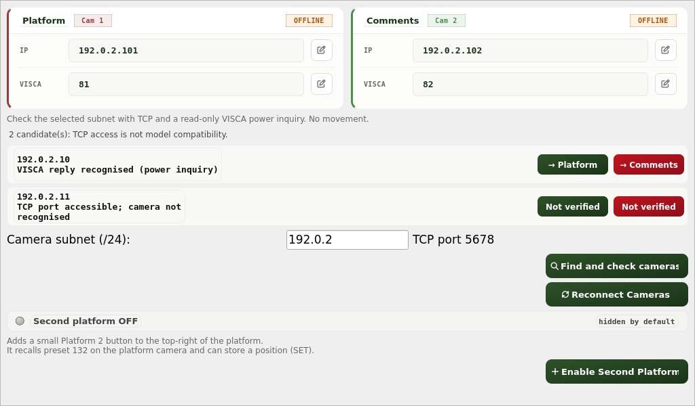
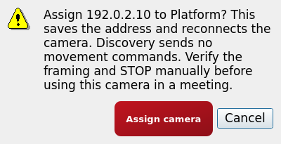

# Find and check cameras

In Admin settings, open **Cameras**, enter the first three IPv4 octets of the
camera subnet (for example `192.168.10` for `192.168.10.0/24`), then choose
**Find and check cameras**. Only scan a network you administer. The selected
scope is explicit; there is no automatic scan on opening the page.

The current configured TCP control port is shown beside the subnet. This is not
a protocol/port profile editor. It does not add UDP VISCA, ONVIF, VLAN traversal
or automatic selection of a network interface. Normal host routing selects the
interface for the entered subnet.

Results distinguish two different facts:

- **TCP port accessible; camera not recognised**: something accepted the TCP
  connection, but did not return the expected VISCA power response. Assignment
  from this result is disabled. It might be another service, a camera with a
  different address/protocol, a standby device or an unsupported response.
- **VISCA reply recognised (power inquiry)**: a bounded, read-only address-1
  inquiry returned a correctly framed power-on/standby value. This is protocol
  recognition, not model identification or proof that all controls work. Existing
  per-role VISCA IDs remain unchanged when an IP is assigned; check those IDs
  manually, especially when using a camera that requires an address other than 1.

Discovery never sends pan, tilt, zoom, home, preset recall/store or power-change
commands. The probe sends only `81 09 04 00 FF`, accepts the standard
`90 50 02 FF` / `90 50 03 FF` power replies, and handles split TCP frames and
preceding ACKs. Timeout, EOF, errors, malformed replies or an ACK alone do not
count as recognition. Each candidate probe has a 0.6-second deadline and a
64-byte response limit; at most eight candidates are probed concurrently.

Choose **Platform** or **Comments** only after checking the address. A separate
confirmation explains that assignment saves the address and reconnects that
role. Cancel makes no configuration change. A rejected assignment is not marked
as saved. Discovery and assignment are blocked during a live session, and discovery
is disabled in simulation so training does not scan real devices. There is no
movement test button or automatic movement after recognition.

Before a meeting, verify the configured camera and VISCA ID, framing and physical
STOP with the hall's normal safety procedure. A green protocol result is not
hardware validation or permission to move a camera.

## Review captures

These are local Qt previews with fake devices and documentation-only IPs, not
screenshots of a hall or proof of camera/Raspberry Pi operation.

## Rollback

Revert this feature commit to restore the previous discovery UI. The feature
adds no config schema or data migration. Reverting code does not undo an address
an administrator has explicitly assigned; restore it through normal settings if
needed. Installer, credentials, backup/restore and PR16 hardening are unchanged.
