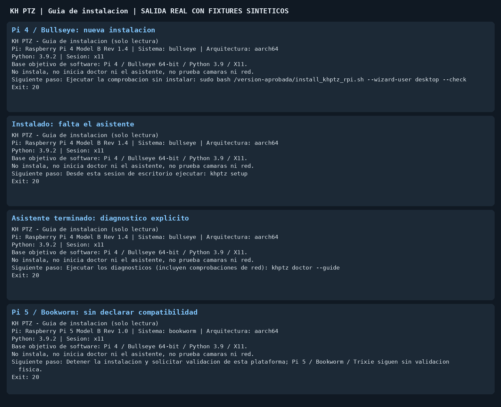

# Guia de instalacion: un siguiente paso

Desde el checkout de una version aprobada, en la terminal del escritorio:

```bash
bash install_khptz_rpi.sh --guide
```

La guia lee modelo de Pi, sistema, arquitectura, Python del sistema, tipo de
sesion y presencia del lanzador y marcador de provision. No necesita root,
no instala, no escribe estado, no ejecuta doctor, no abre el asistente y no
busca ni mueve camaras. Imprime **un siguiente paso** y sale con 20 porque
la instalacion/aceptacion aun no ha terminado; 30 significa estado ilegible.
El usuario se toma de `SUDO_USER`/`USER`; se puede indicar `--wizard-user`.
La guia solo orienta el camino producto/system; no acepta `--dev`, `--atem`,
`--gui-mode` ni `--allow-dirty`. Esas opciones siguen en el instalador normal.

| Evidencia local | Siguiente paso |
| --- | --- |
| Pi/sistema/Python no validados o desconocidos | Detener y pedir validacion |
| Sesion no X11 o desconocida | Abrir el escritorio X11 y repetir |
| Sin lanzador instalado | Ejecutar `--check`, sin instalar |
| Lanzador, sin marcador de provision | `khptz setup` como usuario del escritorio |
| Lanzador y marcador | `khptz doctor --guide`, avisando de las pruebas de red |
| Estado no legible | Pedir revision de permisos, no suponer equipo vacio |

`--check` sigue siendo la comprobacion de requisitos existente. Si termina
bien, ahora imprime un comando de instalacion que conserva sus opciones
seleccionadas y cita rutas/usuario. Ese comando **no se ejecuta automaticamente**.
Antes de ejecutarlo, confirmar revision aprobada y copia de seguridad verificada
segun [la guia de instalacion](INSTALL_RPI.md). El resultado de `--check` no
certifica hardware ni sustituye la aceptacion fisica.

Despues del asistente, `khptz doctor --guide` conserva todos los hallazgos y el
codigo de salida del diagnostico, pero ofrece un solo siguiente paso principal
en lugar de la lista final de acciones. **Doctor si realiza los sondeos normales
de red y camaras**: ejecutarlo solo con permiso para el equipo correspondiente.
`doctor` sin la opcion y `doctor --json` mantienen su salida anterior.
Una configuracion pendiente pide revisar el primer problema pendiente;
no manda reabrir el asistente con `--force` ni sobrescribir datos a ciegas.

La base objetivo de software es Bookworm 64-bit/Python 3.11 en Pi 4 o Pi 5 con X11;
tambien se admite la base original Bullseye 64-bit/Python 3.9 en Pi 4. Detectarla
no prueba esta unidad concreta, pantalla, reinicio ni camaras. Trixie, Wayland,
32 bits y versiones de Python que no sean la del sistema no se declaran
compatibles: el ensayo Bookworm en contenedor no es validacion fisica. Ninguna
ruta de la guia habilita un merge, despliegue o uso en una reunion.

## Captura reproducible, sin dispositivos



Captura de salida de `runtime.install_guide.main` con lecturas de plataforma y
estado sustituidas por fixtures. No representa pruebas en Raspberry Pi real.

## Alcance y vuelta atras

Cambio limitado a orientacion, salida de comprobacion y opcion del diagnostico.
No cambia aprovisionamiento, permisos, servicios, hardening, backup ni restore.
Para deshacerlo, revertir el PR; no se crea estado ni hay migracion de datos.

El wrapper pasa `--no-check-next-action` al hijo solo en la comprobacion: el
hijo conserva diagnosticos y exit code, pero deja al wrapper el unico siguiente
paso. `install.sh --check` directo conserva su salida anterior.

Para la persona que esta delante de la Pi: [Instalar paso a paso](INSTALL_HUMANO.md).
