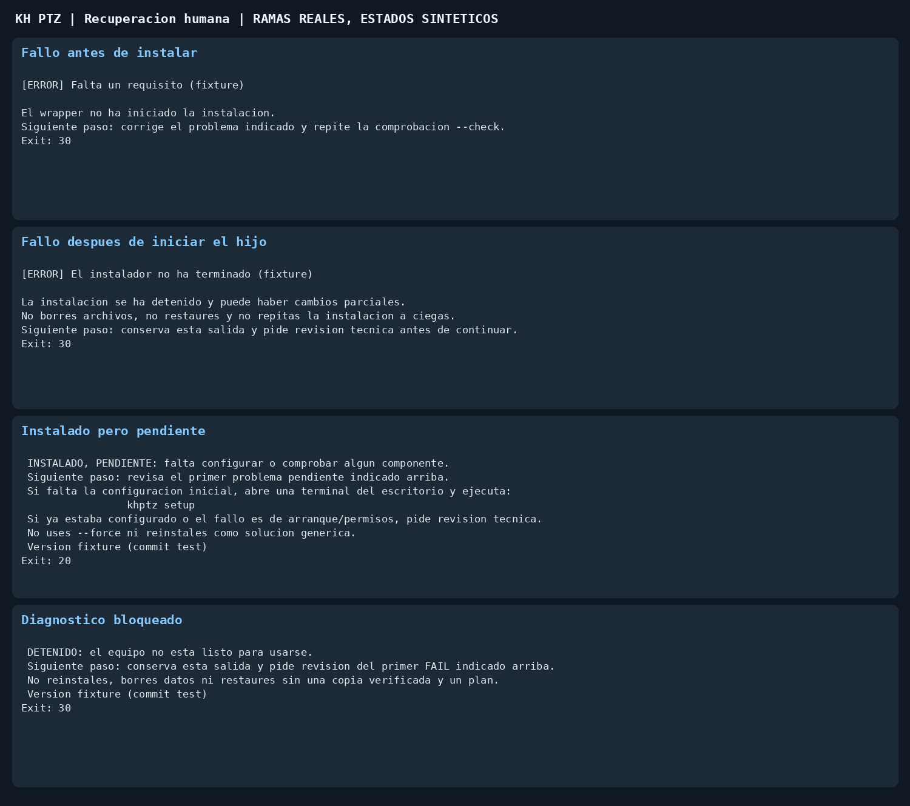
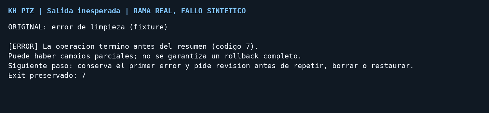

# Instalar con calma, un paso cada vez

Esta hoja es para quien esta delante de la Raspberry Pi. No es una orden para
instalar en un equipo en uso. Necesitas permiso del responsable, una version
aprobada y una copia de seguridad comprobada (o la tarjeta original intacta).
No hagas pruebas durante una reunion. Si no sabes si la copia funciona, para.

## 1. Antes de empezar

Identifica el equipo y abre una terminal de su escritorio como usuario normal.
No uses una conexion SSH como sustituto de la comprobacion de pantalla. Entra
en la carpeta de la version aprobada y ejecuta solo este comando:

```bash
bash install_khptz_rpi.sh --guide
```

Lee la ultima linea, **Siguiente paso**. La guia no instala ni busca camaras.
Puede acabar con codigo 20: significa que queda un paso, no que haya instalado
mal. Codigo 30 indica un problema que debe revisar el tecnico.

- Plataforma aprobada: Pi 4 o Pi 5 con Bookworm 64 bits y su Python 3.11 de
  sistema (tambien Pi 4 con Bullseye y Python 3.9). Trixie, otro Python,
  32 bits o datos desconocidos: parar y pedir validacion. Un ensayo en
  contenedor no prueba esta Pi.
- Sesion distinta de X11 (Bookworm arranca en Wayland por defecto): cambia la
  sesion con `sudo raspi-config` -> Advanced Options -> Wayland -> X11, reinicia
  en el escritorio y repite la guia. El tecnico debe comprobar el escritorio y
  la pantalla; no cambies el sistema operativo ni los permisos por tu cuenta.
- Usuario root: vuelve al escritorio de tu usuario habitual.
- Estado no legible: no lo confundas con una instalacion vacia.

## 2. Comprobar antes de instalar

Ejecuta el comando `--check` que imprime la guia. Si pide la clave de sudo,
escribela solo en la terminal de la Pi, nunca en un chat o en una captura.

- PASS: ese requisito ha pasado. No certifica la instalacion completa.
- WARN: conserva el aviso. Si no sabes si afecta a tu equipo, pregunta.
- FAIL o ERROR: no pases a instalar. Copia el primer mensaje y pide ayuda para
  corregirlo. Repite **la comprobacion**, no una reinstalacion a ciegas.
- Si no encuentra un archivo/carpeta: confirma que estas en el checkout aprobado.
  No descargues scripts sueltos ni copies comandos de otra version.
- Si faltan paquetes o red: que el tecnico confirme primero los paquetes y
  conexion permitidos. No desactives controles de seguridad para continuar.

Cuando pase, el wrapper imprime un unico comando de instalacion. Comprueba
otra vez version aprobada, copia y equipo fuera de servicio antes de ejecutarlo.
No pegues una lista de comandos: ejecuta uno, espera y lee el resultado.

## 3. Si la instalacion se detiene

Puede haber cambiado parte del equipo. El instalador no promete una transaccion
completa ni un rollback total. Conserva la salida y no borres carpetas, cambies
propietarios/permisos, restaures ni pruebes `--force` para ver si funciona.
Pide al tecnico que identifique el primer error, el estado de los servicios y la
copia utilizable antes de elegir entre reparar, repetir o volver atras.

Un reintento solo tiene sentido cuando se conoce la causa, se ha corregido,
se ha confirmado la copia y se mantiene la misma version aprobada. La propiedad
«idempotente» no significa «sin riesgo» ni recuperacion garantizada.

## 4. Asistente de configuracion

En una instalacion nueva, abre el asistente desde la terminal del escritorio:

```bash
khptz setup
```

Comprueba direcciones, nombres y configuracion antes de confirmar. Contraseñas
solo en el asistente, nunca en las notas de soporte. Si cancelas, no des por
terminada la configuracion. Si falla o se cierra, conserva el mensaje y pide
revision antes de abrir reparacion forzada. No eludas la autenticacion.

Si el equipo ya estaba configurado, no vuelvas a configurarlo para resolver
cualquier problema de arranque: puede ser pantalla, permisos o un servicio.

## 5. Comprobar el resultado, sin certificar a ciegas

El diagnostico normal puede contactar con la red/camaras configuradas. Ejecutalo
solo cuando el responsable lo permita. El tecnico usa la identidad de servicio
para no crear logs propiedad de root; no ejecutes `sudo khptz doctor`.

```bash
khptz doctor --guide
```

| Resultado | Que significa | Que hacer |
| --- | --- | --- |
| 0 | Sin bloqueos en los checks ejecutados | Aceptacion fisica pendiente |
| 10 | Operativo con recomendaciones | Guardar avisos y completar aceptacion |
| 20 | Configuracion o comprobacion pendiente | Revisar el primer problema, no forzar setup |
| 30 u otro error | No listo | Parar y pedir revision, no reinstalar por rutina |

Si la pantalla no abre, entra en bucle o no arranca tras iniciar sesion, conserva
el error. No reinicies repetidamente para esconderlo. Pantalla, sesion, arranque,
camara correcta, encuadre y STOP deben verificarse fisicamente antes de una
reunion. Ni un puerto abierto ni un diagnostico verde prueban todo eso.

## 6. Que entregar al tecnico

Version o commit aprobado, paso donde se detuvo, primer ERROR/FAIL, resultado
final y si habia instalacion previa. Guarda la salida local. Antes de compartir
capturas elimina contraseñas, licencias, IPs/datos de la congregacion y nombres
privados. No publiques logs completos ni copias de seguridad en GitHub.

Para diagnostico detallado y recuperacion: [INSTALL_RPI](INSTALL_RPI.md),
[UPDATE_ROLLBACK](UPDATE_ROLLBACK.md) y [GUIDED_INSTALL](GUIDED_INSTALL.md).
Los procedimientos de restauracion requieren permiso, copia verificada y una
persona que pueda recuperar el equipo si fallan.

## Ejemplos de salida



Son ramas reales del wrapper con estados sinteticos, sin ejecutar instalacion.

### Si aparece «termino antes del resumen»

Ha fallado una orden del wrapper fuera de los errores previstos. El resumen
adicional conserva el codigo de error original y no hace reparaciones. Si la
instalacion ya habia comenzado, puede haber cambios parciales. Guarda el primer
error, no solo el resumen final. El aviso no garantiza captura ante un corte de
corriente, cierre forzoso del proceso o fallo del propio sistema de archivos.


