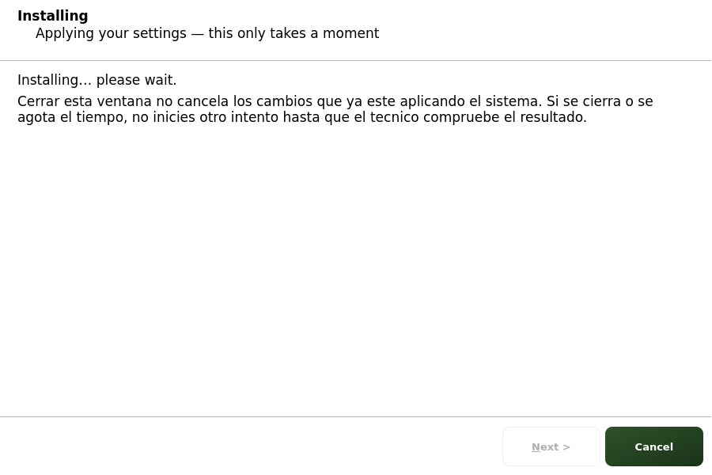

# Cerrar el asistente durante la aplicacion

El asistente y el servicio que aplica los cambios son procesos distintos.
Cerrar, cancelar u ocultar la ventana **no cancela** una solicitud ya entregada
al servicio y no garantiza que se hayan deshecho los cambios.

La pagina de instalacion muestra este aviso y, cuando termina el dialogo, deja
de consultar el resultado mediante su temporizador. Eso solo termina el polling
de la interfaz. No borra la solicitud, no modifica el canal de provision, no
intenta parar el servicio ni vuelve a enviar las respuestas.

Si la ventana se cierra o aparece un timeout, conserva la informacion disponible
y pide al tecnico que compruebe el resultado antes de iniciar otro intento.
El resultado puede ser todavia desconocido. No interpretes Cancelar como
«deshacer» ni el timeout como prueba de que el servicio se ha detenido.

## Pruebas y limites

Pruebas Qt con handoff falso comprueban reject, accept y close: el temporizador
se detiene y no hay nuevo envio ni resultado de exito inventado. Otra prueba
comprueba que reentrar tras un fallo limpia la salida anterior y rearma el
polling. Es una prueba de ciclo de vida de UI, no de recuperacion privilegiada.

No se prueba una Pi, pantalla fisica, contraseñas, red ni provision real. No se
cambia autenticacion, formato del canal o gestion de secretos.

Pendiente separado: impedir que una segunda ventana/reintento se solape con una
operacion que aun esta trabajando e identificar de forma inequivoca a que
solicitud corresponde cada resultado. Este cambio de UI no implementa ese
bloqueo ni autoriza un reintento automatico.

