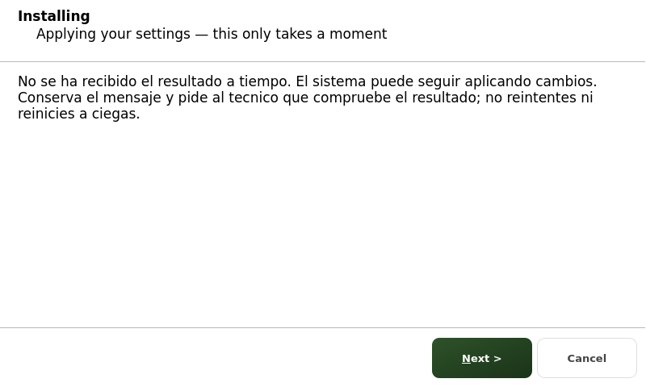

# Tiempo agotado: resultado desconocido

El timeout de la interfaz significa que no ha recibido el resultado a tiempo,
no que la operacion privilegiada haya terminado o se haya cancelado. El mensaje
pide conservar la informacion y que el tecnico compruebe el resultado antes de
reintentar. No recomienda reiniciar a ciegas.

Este cambio corrige solo el mensaje y los comentarios de contrato. No cambia
solicitudes, resultados, permisos, secretos, tiempos ni servicios. No bloquea
reintentos solapados: esa proteccion necesita otro cambio con identidad de
operacion y revision del canal. Un resultado tardio sigue siendo legible por
el handoff, aunque la pagina ya ha detenido su polling al recibir el timeout.

Pruebas: reloj falso, solicitud temporal con datos sinteticos, resultado tardio
y widget Qt real. Ninguna prueba ejecuta provision real ni hardware. Se
comprueba que Next sigue bloqueado y no se envia otra solicitud al mostrar el
aviso. Captura local800x480 inspeccionada, no pantalla fisica. El estilo actual puede
pintar Next verde aun estando deshabilitado; la prueba verifica el estado real
y que un clic no cambia de pagina. Corregir ese estilo es un pendiente separado.

